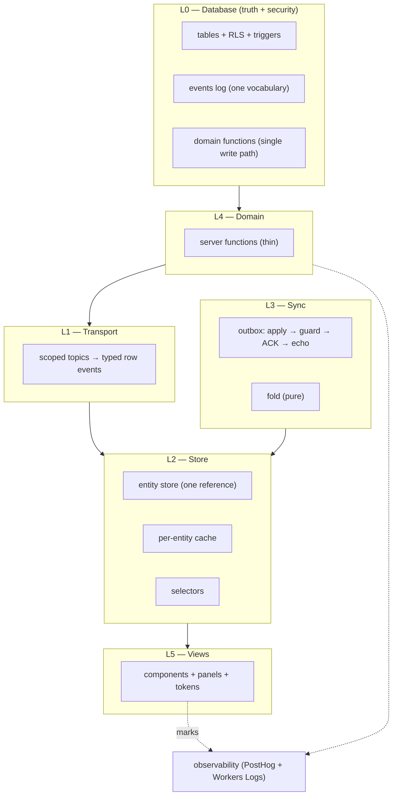

# Flowdeck architecture

The locked architecture. This document is the contract every change is
reviewed against — the UI redesign, new features, and bug fixes all follow
it. Companion docs: the layer contracts in [`layers/`](./layers/), the
decisions with rationale in [`adr.md`](./adr.md), the pipeline in
[`ci-cd.md`](./ci-cd.md), the telemetry contract in
[`observability.md`](./observability.md), and the speed checklist
[`performance-rules.md`](./performance-rules.md).

## The philosophy (five principles)

1. **Postgres is the truth.** RLS is the only security gate; every surface
   (web, MCP, direct SQL) goes through it. Broadcasts are display hints,
   never trusted.
2. **The network only hides latency.** Writes apply locally first (outbox);
   reads paint from the local store first (stale-while-revalidate). Nothing
   the user opens waits on the network the second time.
3. **One reference per thing.** Every entity exists once — in the database,
   in the client store, in the cache. Views reference it by id; a change to
   the entity updates every view in the same frame. A one-row change that
   forces a re-fetch anywhere is a layering bug (the canonical test below).
4. **Extend, don't replace.** The outbox, the fold, the revision cursor are
   assets. We feed them better payloads; we don't swap the engine.
5. **Measured, or it didn't happen.** Every open path has a perf mark and a
   budget; every layer has counters; deploys are gated by CI.

## The layers

| Layer | Contract                                             | Owns                                           | May not                  |
| ----- | ---------------------------------------------------- | ---------------------------------------------- | ------------------------ |
| L0    | [`layers/l0-database.md`](./layers/l0-database.md)   | schema, RLS, triggers, events, domain fns      | know the app             |
| L1    | [`layers/l1-transport.md`](./layers/l1-transport.md) | topics, subscriptions, reconnect, event decode | know entity meaning      |
| L2    | [`layers/l2-store.md`](./layers/l2-store.md)         | entity store, cache, selectors, revisions      | fetch, touch DOM         |
| L3    | [`layers/l3-sync.md`](./layers/l3-sync.md)           | outbox, guards, echo, provisional ops, fold    | know UI                  |
| L4    | [`layers/l4-domain.md`](./layers/l4-domain.md)       | server fns, validation, notifications          | know views               |
| L5    | [`layers/l5-views.md`](./layers/l5-views.md)         | components, panels, design tokens              | fetch, hold server state |

## The canonical test

> **A change to one row — rename a tag — must update every surface in the
> same frame, with zero re-fetches and zero `resync`s.**

If a one-row change triggers a snapshot, a poll, or a refetch anywhere,
the layering is broken. This is the acceptance test for phases 1–3 and the
rule every new feature is reviewed against.

## The locked decisions

Summarized here, full context/decision/consequences in [`adr.md`](./adr.md):

| #   | Decision                                                                      |
| --- | ----------------------------------------------------------------------------- |
| 1   | Client truth = normalized entity store; views derive via selectors            |
| 2   | Cache = per-entity IDB keys (not view blobs)                                  |
| 3   | Delivery = typed row events on scoped topics; `resync` is a fallback          |
| 4   | One `events` table (Jira changegroup pattern); `activity` retires             |
| 5   | Single write path: web + MCP call the same per-op DB functions                |
| 6   | Outbox engine semantics unchanged (Figma write model)                         |
| 7   | Counters materialized by triggers, not per-snapshot RPCs                      |
| 8   | Observability = PostHog free + Workers Logs + perf counters                   |
| 9   | Non-goals: CRDTs, bought sync engines, client SQLite, multi-tab single-writer |
| 10  | Escape hatch at the connection ceiling: Durable Objects hub (L1-only swap)    |
| 11  | Branch model: `main` = prod, `preview` = integration                          |
| 12  | Two Supabase projects (free tier); migrations are the only schema path        |
| 13  | Preview is private: Cloudflare Access on the preview domain                   |
| 14  | Deploys are path-based: migrations → functions → worker, in order             |

## The canonical feature walkthrough

How to add anything new (a surface, an entity, a mutation) — the UI
redesign follows this exact path:

1. **L0**: migration — table + RLS + (if mutable-shared) events trigger.
   If it's a mutation, it becomes a domain function here.
2. **L4**: thin server fn wrapping the domain fn; validation; friendly
   errors; perf mark on the read path.
3. **L1**: the entity rides an existing scoped topic as a typed event —
   new topics require an ADR (connection budget).
4. **L2**: entity lands in the store; selector(s) expose it; cache key
   `type:id` with LRU rank + TTL decided in the same PR.
5. **L3**: if it's a mutation, it's an op: apply/guards/echo registered in
   the op registry; relayed for provisional peers.
6. **L5**: a component reads selectors only. No fetch, no spinner on warm
   open, its own module (not appended to a route).
7. **Measure**: perf mark + budget line; counters for the new path.

## Phases

| Phase | What                                                             | Proof                               |
| ----- | ---------------------------------------------------------------- | ----------------------------------- |
| 0     | CI + observability + **this documentation**                      | baseline numbers; docs merged       |
| 1     | Entity store + selectors; board chips + tag page read through it | rename updates chips in one frame   |
| 2     | Row events: scoped `tags`, join-row events, counters table       | rename = 1 event, no resync         |
| 3     | Events table; live timelines; tag capsule from the log           | 10s poll gone; capsule < 100ms warm |
| 4     | Channel consolidation: 1 board + 1 workspace topic per viewer    | sockets 7 → 2 per viewer            |
| 5     | `mcp_exec` decomposition + single write path                     | new op = one small migration        |
| 6     | Route decomposition (panels out of the board route)              | redesign can start                  |

Each phase ships fully working. No phase requires a big-bang migration.
