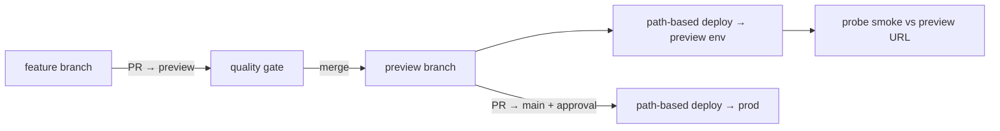

# CI/CD runbook

The pipeline that enforces the architecture. Branch model and environments
are locked in [ADR-11..14](./adr.md); this is the operating manual.

## Environments

|           | Local                                | Preview                             | Prod             |
| --------- | ------------------------------------ | ----------------------------------- | ---------------- |
| Supabase  | CLI stack (`supabase start`, :54321) | free project #2                     | free project #1  |
| Worker    | `pnpm dev:node` (:3000)              | `flowdeck-preview` + Access domain  | `flowdeck`       |
| MCP       | `supabase functions serve mcp`       | deployed to preview project         | deployed to prod |
| Data      | disposable (`db reset`)              | CI-owned test data                  | real             |
| Auth gate | none                                 | Cloudflare Access (email allowlist) | public           |

## Branch flow



- `main`, `preview`: protected, PR-only, all checks required.
- Prod deploys require the `production` environment approval (the release
  click).
- Cut feature branches from `preview`; rebase before PR when `preview`
  moved.
- **Exception — the Phase 0 pipeline itself**: PRs #41/#42 merged straight
  to `main` because the pipeline cannot gate its own birth (preview had no
  CI to run). A one-time bootstrap, recorded here so it stays one — every
  PR after this follows the flow.

## Workflows

### W1 — `quality` (pull_request → preview, main)

Path-classified (the Docker stack is ~60% of a run and only matters when
server/DB code moved):

| Job         | Runs when                          | What                                                                                                                                                              |
| ----------- | ---------------------------------- | ----------------------------------------------------------------------------------------------------------------------------------------------------------------- |
| `classify`  | always                             | paths-filter → ui / server / functions outputs                                                                                                                    |
| `lint`      | always                             | oxlint + tsc (drafts included)                                                                                                                                    |
| `format`    | always                             | prettier --check (drafts included) — the commit hooks' backstop: a `--no-verify` commit still cannot merge                                                        |
| `knip`      | always                             | knip (drafts included) — unused files/dependencies fail the PR; export-level findings are scoped out for now (cleanup follow-up)                                  |
| `client`    | UI paths, non-draft                | build (repo-level public `PREVIEW_*` vars — PR runs have no environment context) + jsdom tests                                                                    |
| `server`    | server/DB paths, non-draft         | local `supabase start && db reset` + node tests (db-guards self-seeds)                                                                                            |
| `functions` | `supabase/functions/**`, non-draft | `deno check` on the MCP function — the only place it's compiled; nothing in the test projects exercises edge functions. Review coverage is pr-intel's tool report |

**Zero provider credentials in this workflow** (ADR-15). Docs-only PRs
run lint+typecheck only (~15s).

Promised follow-up (not in Phase 0): `supabase db push --dry-run` →
PR comment with the migration diff.

### W1b — `pr-intel` (pull_request → preview, main)

Deterministic review aids; read-only except labels + one report comment:

- **Labels** (bot-owned; human labels never touched): `migration`,
  `mcp`, `server`, `client`, `docs`, `infra`, `sync-engine`, `cache`,
  `fold`, `misc` — computed from the diff, pruned when stale.
  Same-repo PRs only (fork PRs run with a read-only token; the writes
  would 403).
- **Migration guard** (blocking, runs for every PR including forks):
  modifying, deleting, or renaming an existing migration fails the PR
  (L0 rule 1 — migrations are append-only; editing one desyncs every
  database that already applied it). Diffs the **merge base**, not the
  branch tip, so a base branch that moved mid-PR can't false-positive.
  Fails closed: a failed diff is a red check, never "clean".
- **MCP tool report**: when `supabase/functions/mcp` changes, diffs the
  TOOLS array against the base and posts ONE comment (upserted per
  push) listing added/removed tools or noting behavior-only changes.

Path-classification knowledge lives in quality.yml's filter and
pr-intel.yml's label regexes — keep them in sync when paths move.

### W2 — `deploy-preview` (push → preview)

Path matrix (dorny/paths-filter), **in order**, environment `preview`:

| Changed                                                                                               | Action                                                    |
| ----------------------------------------------------------------------------------------------------- | --------------------------------------------------------- |
| `supabase/migrations/**`, `supabase/config.toml`                                                      | `supabase db push --db-url` (preview)                     |
| `supabase/functions/**`                                                                               | `supabase functions deploy mcp --no-verify-jwt` (preview) |
| `src/**`, `public/**`, `env.ts`, `vite.config.ts`, `wrangler.jsonc`, `package.json`, `pnpm-lock.yaml` | `CLOUDFLARE_ENV=preview vite build && wrangler deploy`    |

`concurrency: deploy-preview` queues deploys (never cancels a mid-deploy).

### W3 — `deploy-prod` (push → main)

Same matrix against prod refs, gated on the `production` environment
approval. `wrangler deploy` (no `--env` — top level IS production).

### Releases (both deploy workflows)

Every deploy is a visible release — no deploy happens without a record:

- **Tag + GitHub Release**: `preview-rN` / `release-rN` (N = workflow run
  number). Notes = a header (environment, legs deployed, commit link)
  plus **auto-generated notes**: every PR merged since the previous
  release _of the same environment_, with contributor credits — the
  changelog is the release history, assembled by GitHub.
- **Deployment record**: one success `Deployment` on the `preview` /
  `production` environment per deploy — the Environments tab is the
  browsable deploy history. A failed leg never produces a success
  release: the release step runs after the deploy legs, not instead of
  them.

### W4 — `keep-alive` (cron, weekly)

Ping both Supabase projects' REST endpoints (repo-level public variables)
so the free tier never pauses either project.

## Wrangler environments

`wrangler.jsonc`: top level IS production (worker `flowdeck`, prod
Supabase URL in `vars`); `env.preview` deploys as `flowdeck-preview`
with the preview project's URL. **The environment is selected at BUILD
time** (`CLOUDFLARE_ENV=preview vite build`): the Vite plugin flattens
the generated `dist/server/wrangler.json` for that environment, and
`--env` at `wrangler deploy` time has no effect on a flattened config —
the first preview deploy shipped to prod because of exactly that
(caught in the run log: `Uploaded flowdeck`, prod URL in bindings).
Custom domains are attached in the dashboard (they survive deploys;
`routes` stays out of the config so deploys never fight the dashboard).
**Disable each worker's `*.workers.dev` route** — the preview custom
domain is Access-protected, the workers.dev route would bypass it.

Secrets per env: `wrangler secret put SUPABASE_SECRET_KEY --env preview`
vs no flag for prod. Same for `RESEND_*`, `VAPID_*`.

## Secrets (GitHub)

Same name, different value per environment — the workflow declares
`environment:` and GitHub injects the right set; no env-branching in
workflow code.

| Name                      | Type   | `preview` env               | `production` env |
| ------------------------- | ------ | --------------------------- | ---------------- |
| `CLOUDFLARE_API_TOKEN`    | Secret | preview CF token            | prod CF token    |
| `SUPABASE_ACCESS_TOKEN`   | Secret | same (both-project token)   | same             |
| `SUPABASE_DB_PASSWORD`    | Secret | preview DB password         | prod DB password |
| `CF_ACCESS_CLIENT_ID`     | Secret | Access service token ID     | —                |
| `CF_ACCESS_CLIENT_SECRET` | Secret | Access service token secret | —                |

The CF Access pair is for probe scripts hitting human-gated preview paths
(UI smoke tests) — the MCP surface itself is Access-bypassed (see the
preview access map below); MCP clients connect with Flowdeck's own OAuth,
identical to prod.
| `CLOUDFLARE_ACCOUNT_ID` | Variable | same | same |
| `SUPABASE_PROJECT_REF` | Variable | preview ref | prod ref |
| `SUPABASE_POOLER_HOST` | Variable | preview pooler host | prod pooler host |
| `VITE_SUPABASE_URL` | Variable | preview project URL | prod project URL |
| `VITE_SUPABASE_PUBLISHABLE_KEY` | Variable | preview publishable key | prod publishable key |

Repo-level **variables** (scheduled workflows run outside environments):
`PREVIEW_SUPABASE_URL`, `PREVIEW_SUPABASE_PUBLISHABLE_KEY`,
`PROD_SUPABASE_URL`, `PROD_SUPABASE_PUBLISHABLE_KEY` — public-by-design
values for the keep-alive pings.

Supabase token scope (least privilege): Migrations + Edge Functions
read-write on both projects; everything else None. Function secrets
(`APP_ORIGIN`, `MCP_PUBLIC_URL`) are set **once per project in the
provider** — CI deploys things that live in the repo; configuration that
lives in the provider stays in the provider.

Credentials policy: [ADR-15](./adr.md) — PR runs get zero provider
credentials; deploy tokens are scoped, TTL'd, and rotated. Cloudflare
does **not** support per-Worker token scoping — the two-token split buys
independent rotation and audit trail, not access isolation. Wrangler
runtime secrets (Supabase secret key, Resend, VAPID) live in Cloudflare,
not GitHub.

## CI hardening checklist (enforced in every workflow)

- `permissions:` block per workflow — `contents: read` only; deploy
  workflows add nothing else.
- Every `uses:` pinned to a **full commit SHA** (not tags).
- `persist-credentials: false` on checkout steps.
- No `pull_request_target` with PR-head checkout — ever.
- Deploy jobs reference environment secrets only (`environment: preview`
  / `production`), so PR runs cannot read them.
- **Workflow changes update this file in the same commit** — the docs
  are the contract; behavior that outlives its documentation is a bug.
  (This rule exists because the drift bit three reviews in a row.)

## Preview access setup (one-time)

1. DNS: `preview.<domain>` CNAME → the preview worker (Cloudflare zone).
2. Zero Trust → Access → self-hosted app for that hostname; policy: emails
   in the allowlist. Free up to 50 users.
3. **Access bypass apps** (protocol plumbing — never app surfaces):
   - `/.well-known` — RFC 8414 OAuth metadata (public by design)
   - `/api/mcp*` — the MCP machine surface: register (RFC 7591,
     unauthenticated by design, rate-limited), token, protocol, resource
     metadata. The PAT (`Bearer fd_…`) is its security model — identical
     to prod, which has no Access on the app domain.
     The rule: bypass paths are protocol plumbing, never app surfaces. The
     UI and `/mcp/authorize` (the human consent page) stay behind Access.
4. Preview Supabase: auth site URL + redirect URLs = preview domain;
   signups invite-only.
5. Create one preview PAT (in the preview DB) for probe-mcp; store as a
   repo secret.

## Local development

```bash
supabase start                 # Postgres + realtime + auth on :54321
pnpm dev:node                  # SSR in Node (workerd blocks loopback ws)
supabase functions serve mcp   # MCP locally
pnpm test                      # both vitest projects
```

`supabase db reset` rebuilds local from migrations — the only way local
schema ever changes.

## Known gotchas

- Probe scripts hardcode `localhost:3001` + a local Brave path —
  parameterize (`BASE`, headless chromium, Access service-token headers)
  before CI can run them against preview.
- `pnpm dev` (workerd) can't reach local Supabase realtime; `dev:node` is
  the local-dev default.
- Public repo: fork PRs get no secrets (fine — same-repo branches do).
- Prettier/knip: not yet wired — add a normalization PR before enabling
  `prettier --check`; knip after a cleanup pass.
- Dependabot or Renovate on dependencies; knip after the cleanup PR.
- `.env.production` is deleted from the repo — builds read `VITE_*` from
  CI environment variables. Its old values (public URL + publishable key)
  live in git history; they're public-by-design, so no rotation needed.
- The MCP edge function still reads the deprecated
  `SUPABASE_SERVICE_ROLE_KEY`; the migration to the injected
  `SUPABASE_SECRET_KEYS` dictionary is the first order of business after
  the pipeline is verified.
