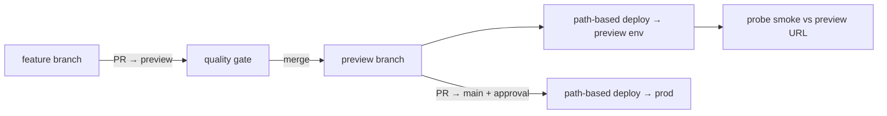

# CI/CD runbook

The pipeline that enforces the architecture. Branch model and environments
are locked in [ADR-11..14](./adr.md); this is the operating manual.

## Environments

| | Local | Preview | Prod |
| --- | --- | --- | --- |
| Supabase | CLI stack (`supabase start`, :54321) | free project #2 | free project #1 |
| Worker | `pnpm dev:node` (:3000) | `flowdeck-preview` + Access domain | `flowdeck` |
| MCP | `supabase functions serve mcp` | deployed to preview project | deployed to prod |
| Data | disposable (`db reset`) | CI-owned test data | real |
| Auth gate | none | Cloudflare Access (email allowlist) | public |

## Branch flow



- `main`, `preview`: protected, PR-only, all checks required.
- Prod deploys require the `production` environment approval (the release
  click).
- Cut feature branches from `preview`; rebase before PR when `preview`
  moved.

## Workflows

### W1 — `quality` (pull_request → preview, main)

1. `pnpm install --frozen-lockfile`
2. `oxlint src`
3. `tsc --noEmit` (add a `typecheck` script)
4. `prettier --check` (changed files)
5. `knip` (advisory until the cleanup PR lands, then blocking)
6. `vite build` (build gate; watch bundle size)
7. `vitest` — client project (jsdom)
8. `vitest` — server project: `supabase start` on the runner first
   (docker available on ubuntu-latest; `db-guards` self-seeds its fixture)
9. `supabase db push --dry-run` → PR comment with the migration diff

### W2 — `deploy-preview` (push → preview)

Path matrix, **in order**:

| Changed | Action |
| --- | --- |
| `supabase/migrations/**` | `supabase db push` (preview ref) |
| `supabase/functions/**` | `supabase functions deploy mcp --no-verify-jwt` (preview) |
| `src/**`, `public/**`, `vite.config.ts`, `wrangler.jsonc`, `env.ts`, `package.json` | `vite build && wrangler deploy --env preview` |
| `docs/**`, `skills/**`, `scripts/**` | quality only |

Then: probe smoke against the preview URL (parameterized `BASE`).

### W3 — `deploy-prod` (push → main)

Same matrix against prod refs, gated on the `production` environment
approval.

### W4 — `keep-alive` (cron, weekly)

Ping the preview Supabase REST endpoint (anon key, one `select`) so the
free tier never pauses the project.

## Wrangler environments

Restructure `wrangler.jsonc`:

```jsonc
{
  "name": "flowdeck",
  "vars": { "SUPABASE_URL": "https://<prod>.supabase.co" },
  "env": {
    "preview": {
      "name": "flowdeck-preview",
      "vars": { "SUPABASE_URL": "https://<preview>.supabase.co" }
    }
  }
}
```

Secrets per env: `wrangler secret put SUPABASE_SECRET_KEY --env preview`
vs no flag for prod. Same for `RESEND_*`, `VAPID_*`.

## Secrets (GitHub)

| Secret | Env scope | Used by |
| --- | --- | --- |
| `SUPABASE_ACCESS_TOKEN` | repo | db push, functions deploy |
| `SUPABASE_DB_PASSWORD_PREVIEW` / `_PROD` | environments | db push |
| `CLOUDFLARE_API_TOKEN`, `CLOUDFLARE_ACCOUNT_ID` | repo | wrangler deploy |
| `PREVIEW_ANON_KEY` | repo | probe smoke |

Wrangler runtime secrets (Supabase secret key, Resend, VAPID) live in
Cloudflare, not GitHub.

## Preview access setup (one-time)

1. DNS: `preview.<domain>` CNAME → the preview worker (Cloudflare zone).
2. Zero Trust → Access → self-hosted app for that hostname; policy: emails
   in the allowlist. Free up to 50 users.
3. Preview Supabase: auth site URL + redirect URLs = preview domain;
   signups invite-only.
4. Create one preview PAT (in the preview DB) for probe-mcp; store as a
   repo secret.

## Local development

```bash
supabase start                 # Postgres + realtime + auth on :54321
pnpm dev:node                  # SSR in Node (workerd blocks loopback ws)
supabase functions serve mcp   # MCP locally
pnpm test                      # both vitest projects
```

`supabase db reset` rebuilds local from migrations — the only way local
schema ever changes.

## Known gotchas

- Probe scripts hardcode `localhost:3001` + a local Brave path —
  parameterize (`BASE`, headless chromium) before CI can run them.
- `pnpm dev` (workerd) can't reach local Supabase realtime; `dev:node` is
  the local-dev default.
- Public repo: fork PRs get no secrets (fine — same-repo branches do).
- Add Prettier config + one normalization PR before enabling
  `prettier --check` in CI.
- Dependabot or Renovate on dependencies; knip after the cleanup PR.
