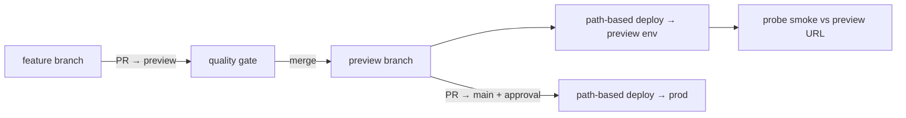

# CI/CD runbook

The pipeline that enforces the architecture. Branch model and environments
are locked in [ADR-11..14](./adr.md); this is the operating manual.

## Environments

| | Local | Preview | Prod |
| --- | --- | --- | --- |
| Supabase | CLI stack (`supabase start`, :54321) | free project #2 | free project #1 |
| Worker | `pnpm dev:node` (:3000) | `flowdeck-preview` + Access domain | `flowdeck` |
| MCP | `supabase functions serve mcp` | deployed to preview project | deployed to prod |
| Data | disposable (`db reset`) | CI-owned test data | real |
| Auth gate | none | Cloudflare Access (email allowlist) | public |

## Branch flow



- `main`, `preview`: protected, PR-only, all checks required.
- Prod deploys require the `production` environment approval (the release
  click).
- Cut feature branches from `preview`; rebase before PR when `preview`
  moved.

## Workflows

### W1 — `quality` (pull_request → preview, main)

1. `pnpm install --frozen-lockfile`
2. `oxlint src`
3. `tsc --noEmit` (`pnpm typecheck`)
4. `vite build` (build gate; client env from repo-level public
   `PREVIEW_*` variables — PR runs have no environment context)
5. `vitest` — client project (jsdom)
6. `vitest` — server project: `supabase db reset` on the runner first
   (docker available on ubuntu-latest; `db-guards` self-seeds its
   fixture). **Zero provider credentials in this workflow** (ADR-15).

Promised follow-up (not in Phase 0): `supabase db push --dry-run` →
PR comment with the migration diff.

### W2 — `deploy-preview` (push → preview)

Path matrix (dorny/paths-filter), **in order**, environment `preview`:

| Changed | Action |
| --- | --- |
| `supabase/migrations/**`, `supabase/config.toml` | `supabase db push --db-url` (preview) |
| `supabase/functions/**` | `supabase functions deploy mcp --no-verify-jwt` (preview) |
| `src/**`, `public/**`, `env.ts`, `vite.config.ts`, `wrangler.jsonc`, `package.json`, `pnpm-lock.yaml` | `vite build && wrangler deploy --env preview` |

`concurrency: deploy-preview` queues deploys (never cancels a mid-deploy).

### W3 — `deploy-prod` (push → main)

Same matrix against prod refs, gated on the `production` environment
approval. `wrangler deploy` (no `--env` — top level IS production).

### W4 — `keep-alive` (cron, weekly)

Ping both Supabase projects' REST endpoints (repo-level public variables)
so the free tier never pauses either project.

## Wrangler environments

`wrangler.jsonc`: top level IS production (worker `flowdeck`, prod
Supabase URL in `vars`); `env.preview` deploys as `flowdeck-preview`
with the preview project's URL. Custom domains are attached in the
dashboard (they survive deploys; `routes` stays out of the config so
deploys never fight the dashboard). **Disable each worker's
`*.workers.dev` route** — the preview custom domain is Access-protected,
the workers.dev route would bypass it.

Secrets per env: `wrangler secret put SUPABASE_SECRET_KEY --env preview`
vs no flag for prod. Same for `RESEND_*`, `VAPID_*`.

## Secrets (GitHub)

Same name, different value per environment — the workflow declares
`environment:` and GitHub injects the right set; no env-branching in
workflow code.

| Name | Type | `preview` env | `production` env |
| --- | --- | --- | --- |
| `CLOUDFLARE_API_TOKEN` | Secret | preview CF token | prod CF token |
| `SUPABASE_ACCESS_TOKEN` | Secret | same (both-project token) | same |
| `SUPABASE_DB_PASSWORD` | Secret | preview DB password | prod DB password |
| `CF_ACCESS_CLIENT_ID` | Secret | Access service token ID | — |
| `CF_ACCESS_CLIENT_SECRET` | Secret | Access service token secret | — |

The CF Access pair is consumed by the probe smoke step (parameterized
probes against the preview URL) — wired when probes land in CI; until
then they sit unused by design, not orphaned.
| `CLOUDFLARE_ACCOUNT_ID` | Variable | same | same |
| `SUPABASE_PROJECT_REF` | Variable | preview ref | prod ref |
| `SUPABASE_POOLER_HOST` | Variable | preview pooler host | prod pooler host |
| `VITE_SUPABASE_URL` | Variable | preview project URL | prod project URL |
| `VITE_SUPABASE_PUBLISHABLE_KEY` | Variable | preview publishable key | prod publishable key |

Repo-level **variables** (scheduled workflows run outside environments):
`PREVIEW_SUPABASE_URL`, `PREVIEW_SUPABASE_PUBLISHABLE_KEY`,
`PROD_SUPABASE_URL`, `PROD_SUPABASE_PUBLISHABLE_KEY` — public-by-design
values for the keep-alive pings.

Supabase token scope (least privilege): Migrations + Edge Functions
read-write on both projects; everything else None. Function secrets
(`APP_ORIGIN`, `MCP_PUBLIC_URL`) are set **once per project in the
provider** — CI deploys things that live in the repo; configuration that
lives in the provider stays in the provider.

Credentials policy: [ADR-15](./adr.md) — PR runs get zero provider
credentials; deploy tokens are scoped, TTL'd, and rotated. Cloudflare
does **not** support per-Worker token scoping — the two-token split buys
independent rotation and audit trail, not access isolation. Wrangler
runtime secrets (Supabase secret key, Resend, VAPID) live in Cloudflare,
not GitHub.

## CI hardening checklist (enforced in every workflow)

- `permissions:` block per workflow — `contents: read` only; deploy
  workflows add nothing else.
- Every `uses:` pinned to a **full commit SHA** (not tags).
- `persist-credentials: false` on checkout steps.
- No `pull_request_target` with PR-head checkout — ever.
- Deploy jobs reference environment secrets only (`environment: preview`
  / `production`), so PR runs cannot read them.

## Preview access setup (one-time)

1. DNS: `preview.<domain>` CNAME → the preview worker (Cloudflare zone).
2. Zero Trust → Access → self-hosted app for that hostname; policy: emails
   in the allowlist. Free up to 50 users.
3. Preview Supabase: auth site URL + redirect URLs = preview domain;
   signups invite-only.
4. Create one preview PAT (in the preview DB) for probe-mcp; store as a
   repo secret.

## Local development

```bash
supabase start                 # Postgres + realtime + auth on :54321
pnpm dev:node                  # SSR in Node (workerd blocks loopback ws)
supabase functions serve mcp   # MCP locally
pnpm test                      # both vitest projects
```

`supabase db reset` rebuilds local from migrations — the only way local
schema ever changes.

## Known gotchas

- Probe scripts hardcode `localhost:3001` + a local Brave path —
  parameterize (`BASE`, headless chromium, Access service-token headers)
  before CI can run them against preview.
- `pnpm dev` (workerd) can't reach local Supabase realtime; `dev:node` is
  the local-dev default.
- Public repo: fork PRs get no secrets (fine — same-repo branches do).
- Prettier/knip: not yet wired — add a normalization PR before enabling
  `prettier --check`; knip after a cleanup pass.
- Dependabot or Renovate on dependencies; knip after the cleanup PR.
- `.env.production` is deleted from the repo — builds read `VITE_*` from
  CI environment variables. Its old values (public URL + publishable key)
  live in git history; they're public-by-design, so no rotation needed.
- The MCP edge function still reads the deprecated
  `SUPABASE_SERVICE_ROLE_KEY`; the migration to the injected
  `SUPABASE_SECRET_KEYS` dictionary is the first order of business after
  the pipeline is verified.
